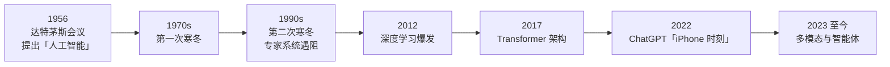

## 1.2 达特茅斯的夏天与漫长的寒冬

AI 发展的历史证明，光有“脑子”（算法）不够，还得有“肌肉”（算力）和“粮食”（数据）。两起两落，皆因“时机未到”。

本节回顾 AI 发展中的几次关键起落，包括历史上的两次“寒冬”，以及当前这轮 AI 浪潮的核心驱动力。

图 1-1：人工智能发展时间线。两次寒冬之后，算力、数据、算法三要素终于齐备，AI 才迎来春天。

### 1.2.1 过于乐观的那个夏天

1956 年的夏天，美国达特茅斯学院，几位年轻的科学家聚在了一起。其中包括后来的图灵奖得主麦卡锡、明斯基等人。这场会议首次正式提出了 **“人工智能”**（Artificial Intelligence）这一术语。

他们开这个会的目标很简单：用 **“一个夏天”** 的时间，解决“机器模拟智能”的问题。

当时的科学家认为，智能无非就是逻辑推理。既然已经造出了能计算的机器，那让机器学会思考也只是时间问题。

这就像是一个刚学会走路的孩子，宣称自己下个月就要去跑马拉松。他们大大低估了“智能”的复杂性，也高估了当时计算机的能力。

这种盲目的乐观，直接导致了 AI 的第一场危机。

### 1.2.2 为什么会经历“寒冬”？

在 AI 的历史上，发生过两次著名的“寒冬”（Funding Winter）。

寒冬是指这样的时期：人们普遍认为 AI 是骗局，投资者撤资，政府停掉经费，科学家甚至不敢在简历上写自己研究 AI。

寒冬的成因可以用经济学里的 **“泡沫破裂”** 来解释：当人们对一项技术的 **期望值**（Expectation）远远超过它的 **实际能力**（Capability）时，灾难就不可避免。

*   **第一次寒冬（70 年代）**：人们发现，那个年代的电脑连几句简单的俄语都翻译不通。
*   **第二次寒冬（90 年代）**：昂贵的“专家系统”维护成本极高，却解决不了稍微变通一点的问题。

> [!NOTE]
> **AI 战胜人类的三座里程碑**
>
> AI 在特定领域超越人类的标志性事件包括：
> - **1997 年**：“深蓝”（Deep Blue）战胜国际象棋世界冠军卡斯帕罗夫，主要依赖于 **强大的算力和穷举搜索**。
> - **2016 年**：“AlphaGo”战胜围棋世界冠军李世石，让大众首次见识到 **深度学习与强化学习** 的巨大威力。
> - **2022 年起**：以 ChatGPT 为代表的大语言模型，在 **自然语言理解和生成** 的许多考试和基准测试中达到了人类水平，例如 [GPT-4 的模拟律师资格考试成绩](https://arxiv.org/abs/2303.08774)约排在考生前 10%。

### 1.2.3 为什么这一轮更扎实？

直到 2012 年，深度学习（Deep Learning）爆发，AI 迎来了真正的春天。特别是 2022 年 ChatGPT 的发布，常被媒体称为 AI 的 **“iPhone 时刻”**。

随后的多模态与智能体浪潮，又把 AI 推向了新的高度。

对于“这次会不会又是泡沫”，更稳妥的判断是：**与前两次相比，这一轮的基础条件更扎实，但仍可能出现周期波动。**

这一次的爆发，是因为三个关键要素终于齐备：
1.  **算力（Chips）**：GPU/专用加速器持续迭代，训练与推理成本快速下降。
2.  **数据（Data）**：互联网数据用完后，高质量的 **合成数据**（Synthetic Data，即 AI 为了训练自己而自动生成的“练习题”）接过了接力棒。
3.  **算法（Algorithm）**：Transformer 架构依然稳健（其原理详见[第 5 章](../05_deep_learning/5.3_architectures.md)），而“更擅长推理/规划”的新一代模型与方法，让机器学会了某种意义上的“慢思考”。

这就好比做饭：以前要么缺米，要么缺锅；现在米、锅和食谱都有了，满汉全席自然就做得出来。

### 1.2.4 “iPhone 时刻”的真正含义

把 ChatGPT 比作 iPhone，并不只是因为它很火。

iPhone 最大的贡献，是把复杂的智能手机，变成了连三岁小孩都会用的设备（多点触控）。

ChatGPT 最大的贡献，是把复杂的 AI，变成了连老奶奶都会用的工具（自然语言交互）。

当一项技术的 **使用门槛被大幅降低** 时，它就不再是少数人的技术，而更接近像水和电一样的基础设施。这才是“春天”真正到来的标志。

### 1.2.5 思考题

我们说这次 AI 爆发是因为“算力、数据、算法”三位一体。

请你思考一下，如果在未来，数据的获取变得更加困难（比如版权保护越来越严，或者高质量数据被用光了），AI 的发展会被锁死吗？还是会像当年克服算力瓶颈一样，出现新的突破？
