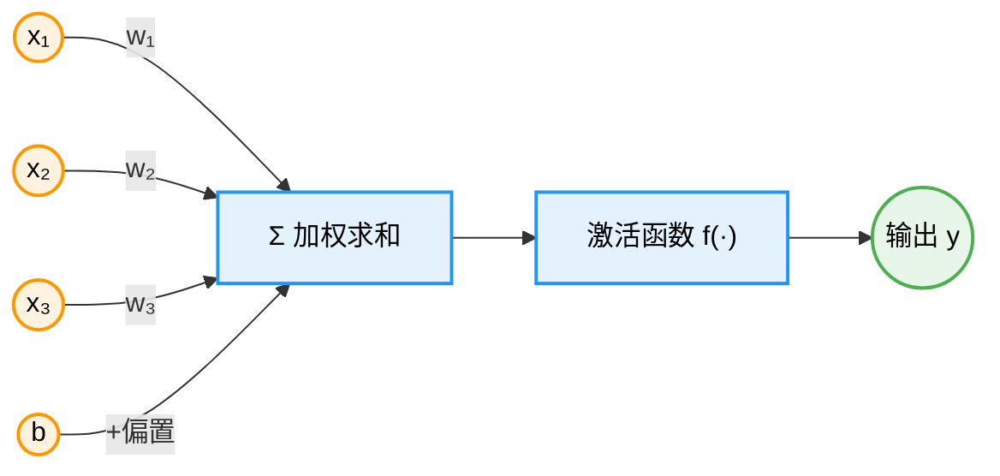

## 5.1 神经网络

> 虽然叫“神经网络”，但它和生物大脑的差距，可能比纸飞机和波音 747 的差距还大。但胜在方向对了：层数越深，表达能力通常越强。

### 5.1.1 仿生学的起点

人类一直有个梦想：既然大脑能产生智能，那我们能不能造一个 **电子大脑**？

于是，科学家模仿大脑的结构，造出了 **“人工神经元”**。

*   **生物神经元**：接收电信号 -> 达到阈值 -> 放电，把信号传给下一个神经元。
*   **人工神经元**：接收数字 -> 加权求和 -> 激活函数 -> 把结果传给下一层。

图 5-1：人工神经元结构

虽然原理简化了无数倍，但当几亿个这样的简单单元连在一起时，就出现了 **涌现（Emergence）**。

就像一只蚂蚁没有智慧，但蚁群却有智慧一样；单个神经元只是个计算器，但亿万个神经元连接起来，就成了 ChatGPT。

### 5.1.2 什么是“深度”？

**深度** 学习之所以叫“深度”，是因为神经网络是分层的。
*   输入层：接收图片像素。
*   隐藏层：负责处理。
*   输出层：告诉你是猫是狗。

如果中间的隐藏层只有几层，叫“浅层网络”（能力有限，只能解决简单问题）。

如果中间有几百层，就叫 **“深度网络”（Deep Neural Network）**。

**深度**，就是网络的 **层数很多**。

图 5-2：深度神经网络的分层结构

每一层都在把信息进行一次“抽象”。
*   第 1 层：看到线条。
*   第 10 层：看到眼睛。
*   第 100 层：看到“这是一只悲伤的猫”。

层数越深，理解得越深刻。因此，现在的模型都要做大、做深。

### 5.1.3 激活函数：画龙点睛

如果只有加减乘除，神经网络就只是一堆线性方程，永远无法解决复杂问题。

必须给它加一点 **非线性** 的“佐料”，这就叫 **激活函数**。

在很长一段时间里，科学家们爱用一种叫 **Sigmoid** 的函数，但它在网络很深时容易“失灵”。现在，最著名的激活函数变成了 **ReLU**。它的名字听起来复杂，逻辑却极其简单：
*   如果输入 < 0，输出 0（不激活）。
*   如果输入 > 0，输出原值（激活，传递信号）。

正是这个简单的开关，让神经网络有了模拟世间万物的能力。

### 5.1.4 思考题

人脑的功率大约只有 20 瓦（相当于一个灯泡），而训练大语言模型（LLM）需要成千上万张显卡，耗电量相当于一个发电厂。

为什么我们在“算力效率”上比 AI 高出那么多？ AI 的进化方向是不是错了？
