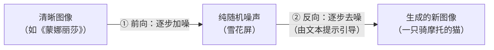

## 9.2 图像生成与扩散模型

> AI 画画并非“拼贴素材”，而是从噪点中一步步“雕刻”出图像。

### 9.2.1 以前的 AI 画画：像拼贴

在 2022 年之前，AI 主要是靠 **GAN（生成对抗网络）** 画画。

它的做法是让两个 AI 互相对抗：
*   **骗子（生成器）**：拼命造假画。
*   **警察（判别器）**：拼命抓假画。

对抗到最后，骗子的技艺大涨，连警察都分不清真假。

但 GAN 生成的图往往细节失真，而且内容很难控制。

### 9.2.2 现在的 AI 画画：扩散模型

扩散模型并非在 2022 年凭空产生，它有更早的学术基础：
1. **理论提出**：2015 年左右扩散概念初步提出，随后在 2020 年的经典论文**DDPM**（Denoising Diffusion Probabilistic Models）中得到验证，证明了从纯噪声中分步还原出高质量图像的潜力。
2. **算力破局**：在 2021-2022 年间，**潜在扩散模型（LDM，Latent Diffusion Models）** 将降噪过程转移到压缩的“潜在空间”中，大幅降低了对显卡算力的需求。
3. **产品爆发**：到了 2022 年，基于 LDM 架构的**Stable Diffusion**宣布开源，商业工具**Midjourney** 同期推出，AIGC 图像生成的产品生态由此迅速成形。

扩散模型的原理可以想象成 **“修复文物”** 的过程，只是先破坏、再修复：
1.  **加噪（破坏）**：把一张《蒙娜丽莎》一点点泼上墨水（噪点），直到它变成一张完全看不清的雪花屏。
2.  **去噪（修复）**：AI 学习这个过程的逆过程。
    *   给它一张雪花屏（随机噪声）。
    *   告诉它：“这就叫 '一只骑摩托的猫' 的雪花屏”。
    *   AI 开始一点点把噪点擦掉。
    *   随着噪点消失，一只猫的轮廓浮现出来，然后是毛发，然后是摩托车……

图 9-1：扩散模型的「加噪—去噪」过程。模型在训练时学习加噪的逆过程；生成时便能在文本提示的引导下，从纯随机噪声一步步还原出图像。

### 9.2.3 为什么 AI 怕画手？

AI 画的脸往往很精致，但手经常是 6 根指头，或者长得像爪子。

原因在于，扩散模型的学习素材里，人脸通常清晰、标准。

而照片里的手经常模糊、被遮挡、姿态各异（拿杯子、插口袋）。

AI 没有学会手的解剖结构，只是在 **“模仿像素的排列”**：它判断这里应该有一堆肉色的东西，但不会去核对是不是 5 根。

（注：近两年的新版本在手部细节上已有明显改善，但复杂姿态下仍可能出现失真。）

### 9.2.4 思考题

AI 生成的画，算不算 **“艺术”**？

如果 AI 学习了梵高所有的画，然后生成了一幅“梵高风格”的新作，那这幅画的 **版权** 应该归谁？

是归开发 AI 的公司？归输入提示词（Prompt）的用户？还是归梵高（的后人）？

这是目前法律界最棘手的问题。
