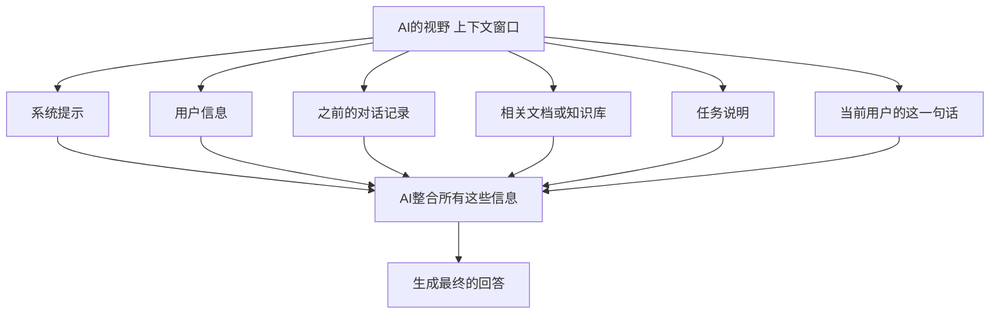
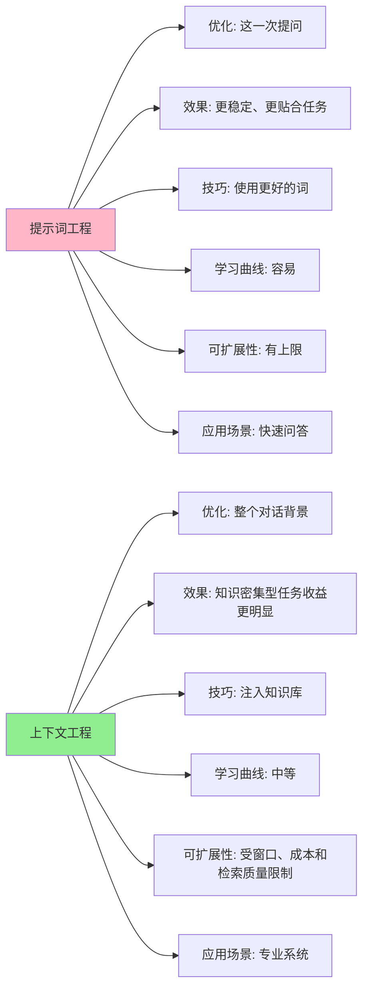

## 12.5 上下文工程：AI 时代的基本素养

> 同样的问题，不同的上下文，AI 给出完全不同的答案

### 12.5.1 一个真实的例子

想象你问 ChatGPT：“推荐一部电影”。

AI 的回答可能很普通：《肖申克的救赎》、《楚门的世界》之类。

但如果你告诉 AI：
- “我的工作是医生，每天都很疲惫”
- “我喜欢看需要大脑思考的电影”
- “我不喜欢暴力镜头”
- “我最近看了《盗梦空间》和《记忆碎片》”
- “我的假期只有 3 小时”

AI 给出的推荐就完全不同了：《十二怒汉》（几乎全片都是陪审团讨论，需要思考，没有暴力镜头，片长约 1 个半小时）、《心灵奇旅》（节奏舒缓，探讨人生意义，适合疲惫时观看）。

两种问法中，**提示词都只是“推荐一部电影”**，但**上下文** 完全不同，所以答案也不同。

### 12.5.2 什么是上下文？

**上下文（Context）** 是指 AI 做决定时能看到的所有信息。



当前的一句话（提示词）在其中占比很小，AI 看重的是整个背景信息。

> 💡 关于上下文工程的完整介绍，请参阅《上下文工程指南》。

### 12.5.3 为什么上下文工程这么重要？

#### 理由 1：人类也是这样工作的

想象你去看医生：

情景 A：医生什么都不知道，只听你说“我很累”
- 医生会很困惑
- 可能建议：多休息
- 判断只能停留在很粗的层面

情景 B：医生知道你的完整医疗史、工作压力、生活方式
- 医生能做出准确判断
- 可能发现潜在疾病
- 更容易提出贴合你情况的判断

**同样的问题，上下文的差异决定了答案的质量。** AI 也是如此。

#### 理由 2：AI 的关键限制是上下文窗口

不同 AI 模型的上下文窗口大小差异很大，窗口大小决定了你一次能交给 AI 的信息量。因此必须精心设计这有限的上下文，让 AI 在限制之内做出最好的决定。

### 12.5.4 上下文的三个层次

#### 第一层：对话上下文

```text
最简单的上下文：之前的对话记录

你：3乘以5是多少？
AI：15

你：再乘以2？
AI：30（理解了"再"指的是上一个结果）

如果没有对话上下文，AI就不理解你的"再"。
```

现有 AI 工具都支持这一层。

#### 第二层：知识库上下文

```text
把你的知识喂给AI

你的公司手册 → 向量数据库 → AI在回答时搜索相关部分 → AI基于这些部分回答

例子：
用户问："我们的休假政策是什么？"

没有RAG：AI可能说"我不知道"或基于通用知识瞎说

有RAG：
1. 搜索公司手册中"休假"相关的部分
2. 找到："员工每年享受20天带薪假期"
3. AI精确回答

结果：答案从"不知道"变成"精确回答"
```

#### 第三层：系统集成上下文

```text
让AI实时访问外部系统

没有MCP：
用户："我的日历有什么安排？"
AI："我看不到你的日历"

有MCP（Model Context Protocol）：
用户："我的日历有什么安排？"
AI：[调用MCP接口] → [查询Google Calendar]
    → "你下午3点有个与张三的会议"

AI不再是"知道"的东西，而是能"看到"实时信息
```

### 12.5.5 上下文 vs 提示词：根本区别



### 12.5.6 实际效果对比

#### 例子 1：代码生成

**只用提示词：**
```text
提示词："用Python写一个快速排序"

结果：获得教科书级的通用快速排序
问题：
- 不符合你的代码风格
- 不包含你项目的特定需求
- 需要大量修改
```

**用上下文工程：**
```text
上下文：
1. 系统提示："你是我的代码助手，熟悉我的项目风格"
2. 我的编码规范（15行）
3. 我项目的现有代码（200行）
4. 这个函数需要与之集成的代码

提示词："用Python写一个快速排序"

结果：生成的代码
- 符合我的风格
- 完美集成到项目中
- 基本不需要修改
```

效果差异：只给一句提示词时，后续往往需要较多返工；补充项目上下文后，返工通常集中在细节调整和人工验收。

#### 例子 2：论文写作助手

**没有上下文：**
```text
用户："帮我写一篇关于AI的论文"
AI："AI是...（很通用的内容）"
```

**有上下文：**
```text
上下文：
1. 论文的标题和摘要
2. 已有的研究背景（3页）
3. 期刊的格式要求
4. 你以前写过的2篇论文（作为写作风格参考）
5. 相关的研究文献列表

提示词："帮我完成第3章"

结果：
- 风格与你之前的论文一致
- 引用格式正确
- 深度和专业性符合期刊要求
- 逻辑与前面章节连贯
```

#### 例子 3：客服机器人与知识库

**没有上下文的客服 AI：**
```text
用户："我的订单为什么还没发货？"
AI："您可以到订单页面查看物流信息..."（通用回答）

问题：
- 不知道用户的订单状态
- 不知道公司的配送政策
- 不知道当前是否有库存问题
- 可能无法解决用户的实际问题
```

**有 RAG 上下文的客服 AI：**
```text
上下文：
1. 用户账号的订单历史和详细信息
2. 当前订单的物流跟踪数据（实时）
3. 公司常见问题库和配送政策文档
4. 当前库存和发货状态
5. 用户之前的投诉和解决方案

提示词："我的订单为什么还没发货？"

AI的实际回答：
"您的订单（编号#12345）已于1月15日确认。
由于2024年末高峰期，当前配送周期为7-10个工作日。
预计发货时间：1月20日。
如需加急，我们提供次日达服务（额外$5）。
您之前对订单#11234也等待过发货，那一次最终提前1天到达。"

效果：具体、有针对性、能解决问题
```

#### 例子 4：法律文档分析助手

**没有上下文：**
```text
用户："这份合同对我有利吗？"
AI给出通用的法律建议，可能不适用于你的具体情况

问题：
- 不知道法律管辖地
- 不知道行业背景
- 不知道你的具体权益
- 可能给出有风险的建议
```

**有上下文的法律助手：**
```text
上下文：
1. 用户的行业背景和业务模式
2. 适用的法律框架（所在国家/地区）
3. 用户之前签过的类似合同及其教训
4. 行业的标准合同条款
5. 用户的优先级和风险承受度

提示词："这份合同对我有利吗？"

AI的分析：
"基于你的SaaS创业背景和中国管辖：

✓ 有利的条款：
- 知识产权归属明确
- 赔偿责任有限制

✗ 风险条款：
- 第3.2条：'甲方可随时修改服务条款'
  → 对标准的条款应该是'30天预告后修改'

- 第5.1条：'乙方需提供无限技术支持'
  → 根据你以前的合同，应该限制为'工作时间内'

🔧 建议修改：
1. 在第3.2条添加'30天预告期'
2. 在第5.1条添加'每月200小时上限'
..."

效果：专业、细致、有可执行的建议
```

#### 例子 5：编程助手与代码库上下文

**没有上下文：**
```text
用户："帮我写一个API接口"
AI："这是一个通用的REST API示例..."

问题：
- 不知道你的技术栈
- 不知道你的代码风格
- 不知道已有的项目结构
- 生成的代码可能无法直接用
```

**有上下文的编程助手（MCP 集成）：**
```text
上下文：
1. 你的项目代码库（获取当前的架构）
2. 项目的技术栈和依赖列表
3. 你的编码规范文档
4. 已有的相似功能代码
5. 项目的数据库Schema

提示词："帮我写一个用户认证API"

AI的代码生成：
- 自动使用你项目的框架（如FastAPI）
- 遵循你的命名规范和文件组织
- 与现有的数据库Schema兼容
- 集成到你的错误处理系统
- 包含与你项目一致的日志和监控

结果：生成的代码开箱即用，基本不需要修改
```

### 12.5.7 成本与权衡

上下文工程的成本：

```text
向量数据库成本：
- 小规模原型：可能落在免费层或开发者层，但会受存储、请求量、索引数等限制
- 托管生产环境：通常包含月度最低消费或用量计费，具体以 Pinecone、Weaviate、Zilliz 等厂商价格页为准
- 大规模或合规部署：通常需要专用集群、私有网络、备份和支持合同

API成本：
- 提示词工程：消耗较少token（提示词短）
- 上下文工程：消耗更多token（上下文长）

权衡：
上下文越长，token、检索和维护成本通常越高；效果是否提升，需要用准确率、召回率、返工率或人工验收来衡量

ROI分析：
如果你的工作高度依赖专有知识，先做小规模试点，再决定是否投入完整系统
```

### 12.5.8 谁应该学习上下文工程？

#### 必须学：

1. **AI 产品经理**：决定产品的上下文架构
2. **AI 工程师**：构建 RAG 和 MCP 系统
3. **知识工作者**：需要 AI 辅助的专业人士

#### 应该学：

1. **管理者**：了解 AI 的真实能力
2. **学生**：为 2030 年做准备

### 12.5.9 本部分的学习路线

```text
第12.5节（当前）：上下文工程概念
   ↓
本节 12.5.4：上下文的三个层次（含RAG）
   ├─ 第二层：知识库上下文
   ├─ 向量与相似性搜索
   └─ 实际的RAG系统设计

第十四章：AI 智能体与多智能体系统
   ├─ 14.1-14.2 智能体感知、规划与行动（含 MCP 协议）
   ├─ 14.3 低代码智能体开发平台（Coze、Dify 等）
   └─ 14.4 多智能体协作系统
```

### 12.5.10 与其他章节的联系

📖 **延伸阅读**：
- 想深入学习提示词工程的基础？请参阅[第十章“主流 AI 工具使用指南”](../10_ai_tools/README.md)与[第十一章“提示词工程入门”](../11_prompt_basics/README.md)
- 想了解多智能体如何协作？请参阅第十四章中的 [14.4 节“多智能体协作系统”](../14_agents/14.4_multi_agent_systems.md)，其中上下文工程对多智能体间的通信很重要
- 量子计算为什么帮不上检索和 RAG 的忙？请参阅 [16.2 节“量子计算与 AI 的未来”](../16_ai_hardware_quantum/16.2_quantum_computing.md)中“什么问题量子计算机不擅长”的部分

### 12.5.11 关键要点总结

1. **上下文 > 提示词**
   - 同样的提示词，不同的上下文，答案可能完全不同
   - 提示词值得优化，但在知识密集型任务里，仅优化提示词通常不够

2. **三层上下文**
   - 对话历史（所有 AI 工具都有）
   - 知识库（通过 RAG 实现）
   - 系统集成（通过 MCP 实现）

3. **这是未来**
   - 提示词工程仍有价值，但上下文工程更接近真实 AI 应用系统的工作方式
   - 能把知识库、工具和验收标准组织清楚的人，会更容易做出可靠的 AI 工作流

### 12.5.12 思考题

1. 你现在使用 AI 的方式中，什么地方可以通过上下文工程大幅改进？

2. 如果你有机会给 AI 注入 10KB 的额外上下文，你会注入什么信息？

3. 你能想到哪些场景，MCP 的实时系统集成会在其中从根本上改变做事方式？
