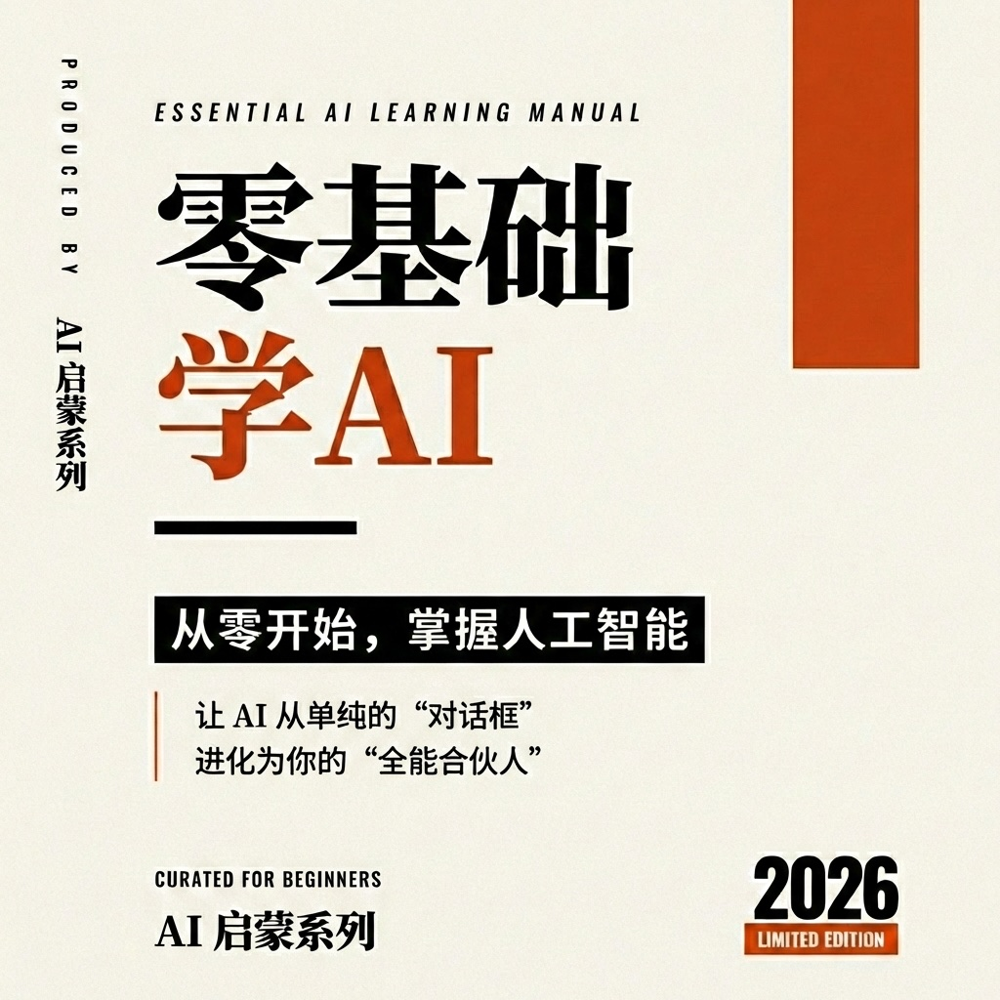

# 零基础学 AI

从认识 AI 到用它解决日常问题，无需编程基础。

**[在 GitBook 阅读第一章 · 走进人工智能世界](https://yeasy.gitbook.io/ai_beginner_guide/di-yi-bu-fen-ai-ji-chu-ru-men/01_ai_intro)**

[全书目录（GitHub）](https://github.com/yeasy/ai_beginner_guide/blob/main/SUMMARY.md) · [正式 PDF（发布页）](https://github.com/yeasy/ai_beginner_guide/releases/latest)



## 关于本书

人工智能（AI）正在改变我们的生活和工作方式。从智能手机上的语音助手，到能够与人流畅对话的聊天机器人，再到自动驾驶汽车和医疗诊断系统，AI 技术已经渗透到各行各业。

然而，对于许多人来说，AI 仍然是一个神秘而遥远的概念。*什么是机器学习？深度学习和机器学习有什么区别？ChatGPT、Claude、Gemini 这些工具背后的技术原理是什么？如何才能有效地使用这些 AI 工具来提升工作效率？*

这本书试图用最朴素的语言回答这些问题。它面向完全零基础的读者，从 AI 的基本概念出发，逐步走向核心技术原理，最后落到实际应用技能。无论你是好奇 AI 世界的普通用户，还是希望将 AI 技术应用于工作的职场人士，都能在这里找到一条清晰的学习路径。

## 从哪里开始

- **第一次接触 AI** · 从[第一章](https://yeasy.gitbook.io/ai_beginner_guide/di-yi-bu-fen-ai-ji-chu-ru-men/01_ai_intro)开始，先了解人工智能有哪些类型、能做哪些事。
- **想先动手试试** · 打开[提示词黄金三原则](https://yeasy.gitbook.io/ai_beginner_guide/di-san-bu-fen-shi-zhan-ying-yong-ji-qiao/11_prompt_basics/11.2_principles)，按书中的模板改写一个日常提问，对照两次回答。
- **想用代码验证原理** · 具备 AI 基础并能用 Python 运行脚本的读者，可以读[机器学习原理](https://yeasy.gitbook.io/ai_beginner_guide/di-er-bu-fen-he-xin-ji-shu-jie-xi/04_machine_learning)，并做一个[线性回归实验](https://github.com/yeasy/ai_beginner_guide/blob/main/labs/README.md#运行方式)。

基础使用与工程实践两条路线的前置条件、练习任务和验收标准见[附录 D · AI 学习路线图](https://yeasy.gitbook.io/ai_beginner_guide/fu-lu/appendix_d_learning_path)。

<details>

<summary>按方向选读</summary>

- **人文与职场应用** · 先读第 1–3 章，再从[第 10 章](https://yeasy.gitbook.io/ai_beginner_guide/di-san-bu-fen-shi-zhan-ying-yong-ji-qiao/10_ai_tools)开始练工具和提示词，最后选读[第 15 章](https://yeasy.gitbook.io/ai_beginner_guide/di-si-bu-fen-jin-jie-yu-zhan-wang/15_ethics_future)。
- **AI 产品** · 先读第 1–3 章，再读第 10–13 章，重点看[第 13 章的应用场景](https://yeasy.gitbook.io/ai_beginner_guide/di-san-bu-fen-shi-zhan-ying-yong-ji-qiao/13_scenarios)。
- **管理与决策** · 先读第 1–3 章，再从[第 14 章](https://yeasy.gitbook.io/ai_beginner_guide/di-si-bu-fen-jin-jie-yu-zhan-wang/14_agents)开始，了解智能体、AI 风险和技术趋势。

</details>

## 全书结构

- **AI 基础入门（第 1–3 章）** · 理解 AI 的基本概念、发展历程与应用。从[第 1 章 走进人工智能世界](https://yeasy.gitbook.io/ai_beginner_guide/di-yi-bu-fen-ai-ji-chu-ru-men/01_ai_intro)开始。
- **核心技术解析（第 4–9 章）** · 理解机器学习、深度学习、大模型与多模态。从[第 4 章 机器学习原理](https://yeasy.gitbook.io/ai_beginner_guide/di-er-bu-fen-he-xin-ji-shu-jie-xi/04_machine_learning)开始。
- **实战应用技巧（第 10–13 章）** · 使用 AI 工具，练习提示词和上下文工程。从[第 10 章 主流 AI 工具使用指南](https://yeasy.gitbook.io/ai_beginner_guide/di-san-bu-fen-shi-zhan-ying-yong-ji-qiao/10_ai_tools)开始。
- **进阶与展望（第 14–16 章）** · 了解智能体、安全伦理、AI 硬件与量子计算。从[第 14 章 AI 智能体与多智能体系统](https://yeasy.gitbook.io/ai_beginner_guide/di-si-bu-fen-jin-jie-yu-zhan-wang/14_agents)开始。

## 延伸阅读

- [大模型提示词工程指南](https://yeasy.gitbook.io/prompt_engineering_guide/) · 系统练习任务拆解和提示词设计。
- [智能体 AI 权威指南](https://yeasy.gitbook.io/agentic_ai_guide/) · 深入理解智能体的架构与协作。
- [大模型原理与架构](https://yeasy.gitbook.io/llm_internals/) · 深入理解 Transformer、训练和推理。

<details>

<summary>更多系列图书</summary>

- [大模型上下文工程权威指南](https://yeasy.gitbook.io/context_engineering_guide/)
- [Claude 技术指南](https://yeasy.gitbook.io/claude_guide/)
- [大模型安全权威指南](https://yeasy.gitbook.io/ai_security_guide/)
- [OpenClaw 从入门到精通](https://yeasy.gitbook.io/openclaw_guide/)
- [智能体 Harness 工程指南](https://yeasy.gitbook.io/harness_engineering_guide/)

</details>

## 反馈与贡献

欢迎在 [GitHub Issues](https://github.com/yeasy/ai_beginner_guide/issues) 报告勘误或提出建议，也可以[提交 Pull Request](https://github.com/yeasy/ai_beginner_guide/pulls)。

<details>

<summary>本地开发与预览</summary>

安装 [mdPress](https://github.com/yeasy/mdpress) 后，在仓库根目录启动本地预览，再打开 `http://localhost:9000`。

```bash
brew tap yeasy/tap && brew install mdpress
mdpress serve
```

[默认分支 PDF 预览版](https://github.com/yeasy/ai_beginner_guide/releases/download/preview-pdf/ai_beginner_guide.pdf)随主线更新，正式版本以发布页为准。

</details>

## 许可证

本书采用 [CC BY-NC-SA 4.0](https://creativecommons.org/licenses/by-nc-sa/4.0/) 许可证。
